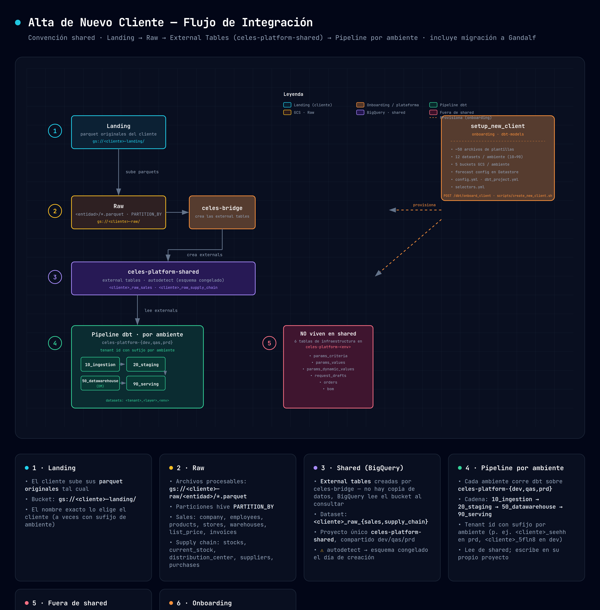

# Alta de Nuevo Cliente — Flujo de Integración

> Convención shared: Landing → Raw → External Tables `celes-platform-shared` → Pipeline por ambiente.
> Aplica a nuevo cliente y a la migración a Gandalf.

## Diagrama

## Paso a paso

| # | Paso | Qué ocurre | Detalle técnico |
|---|------|------------|-----------------|
| **1** | **Landing** | El cliente sube sus **parquet originales** tal cual. El nombre del bucket lo elige el cliente (a veces con sufijo de ambiente). | `gs://<cliente>-landing/` |
| **2** | **Raw** | Archivos procesables con **particiones hive** `PARTITION_BY`. **Sales:** company, employees, products, stores, warehouses, list_price, invoices · **Supply chain:** stocks, current_stock, distribution_center, suppliers, purchases | `gs://<cliente>-raw/<entidad>/*.parquet` |
| **3** | **Shared** | `celes-bridge` crea las **external tables** — *no hay copia de datos*: BigQuery lee el bucket al consultar. Proyecto único `celes-platform-shared`, compartido dev/qas/prd. ⚠ autodetect → esquema congelado el día de creación | `<cliente>_raw_{sales,supply_chain}` |
| **4** | **Pipeline** | Cada ambiente corre dbt sobre su proyecto, **leyendo de shared** y escribiendo en el propio. Cadena: `10_ingestion → 20_staging → 50_datawarehouse → 90_serving`. El tenant id lleva **sufijo por ambiente** (p. ej. `<cliente>_seehh` en prd, `<cliente>_5fln8` en dev) | `celes-platform-{dev,qas,prd}` |
| **5** | **Fuera de shared** | **6 tablas de infraestructura** de supply_chain siguen en `celes-platform-<env>`, no en shared: params_criteria, params_values, params_dynamic_values, request_drafts, orders, bom. ⚠ No reportarlas como «tabla inexistente» en shared | `celes-platform-<env>` |
| **6** | **Onboarding** | `setup_new_client` (dbt-models): provisiona datasets, buckets y código **antes** del pipeline. Copia ~50 archivos de plantillas (`template_ → <cliente>_`), 12 datasets/ambiente, 5 buckets GCS/ambiente y la config de forecast en Datastore. Aplica a nuevo cliente **y** a migración a Gandalf | `POST /dbt/onboard_client` · `scripts/create_new_client.sh` |

## Puntos que conviene tener en cuenta

- **External tables, no materialización.** En `celes-platform-shared` no hay copia de datos: las tablas apuntan al bucket y BigQuery lo lee en cada consulta.
- **Esquema congelado.** Las externals se crean con *autodetect*: si el cliente cambia o agrega columnas, la tabla no lo ve. Se mide con `INFORMATION_SCHEMA.COLUMNS` contra el footer del parquet.
- **Proyecto único para el raw.** A diferencia de la convención legacy (`celes-platform-{app,prd}` por tenant), en shared dev/qas/prd comparten el mismo dataset físico `<cliente>_raw_*`.
- **Migración a medias.** «Migrado a shared» no es binario: puede haber solo una parte de las entidades en shared mientras el tenant legacy sigue corriendo en prd. Se mide en ambos lados (conteo de tablas shared + antigüedad de las capas legacy).

---
*Celes · Convención shared · Incluye migración a Gandalf · 2026*
